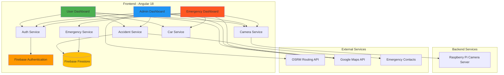
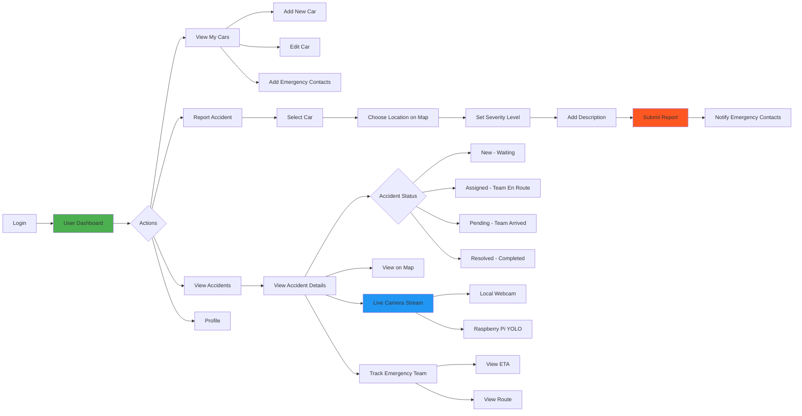
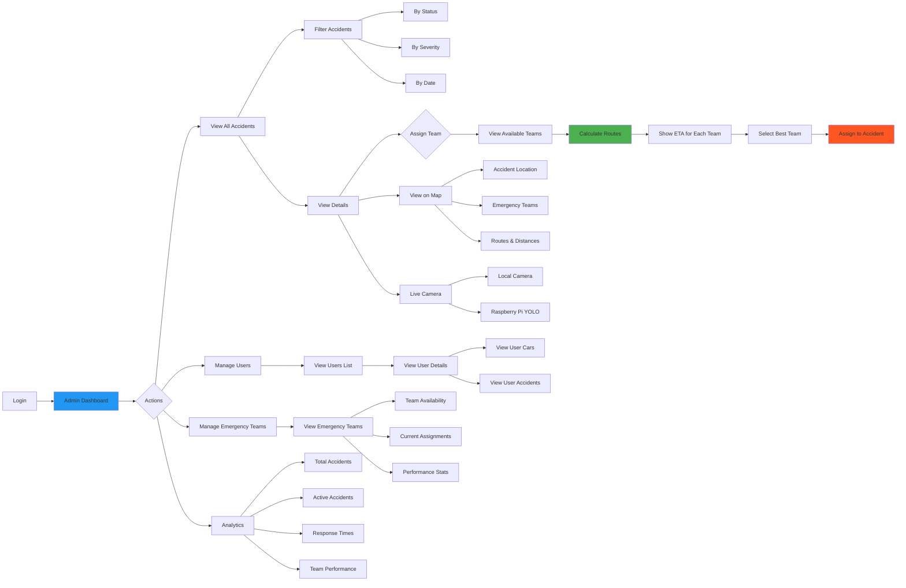
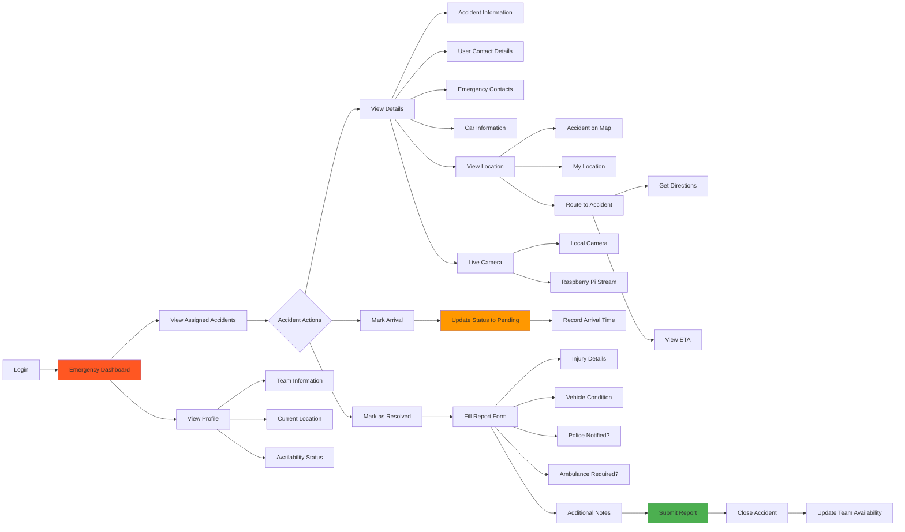

# 🚗 CrashXpert v1.0

**Real-time Car Accident Management & Emergency Response System**

[](https://angular.io/)
[](https://firebase.google.com/)
[](https://www.typescriptlang.org/)
[](https://leafletjs.com/)
[](https://www.raspberrypi.org/)
[](https://www.espressif.com/)
[](LICENSE)

---

## 📋 Table of Contents

- [Overview](#overview)
- [System Architecture](#system-architecture)
- [User Flow Diagrams](#user-flow-diagrams)
  - [User Flow](#user-flow)
  - [Admin Flow](#admin-flow)
  - [Emergency Team Flow](#emergency-team-flow)
- [Features](#features)
- [Tech Stack](#tech-stack)
- [Project Structure](#project-structure)
- [Getting Started](#getting-started)
  - [Prerequisites](#prerequisites)
  - [Installation](#installation)
  - [Configuration](#configuration)
- [User Roles & Permissions](#user-roles--permissions)
- [Core Functionalities](#core-functionalities)
- [Hardware Integration](#hardware-integration)
- [Security](#security)
- [API Reference](#api-reference)
- [Contributing](#contributing)
- [License](#license)

---

## 🎯 Overview

**CrashXpert** is a comprehensive, real-time car accident management platform designed to revolutionize emergency response workflows. The system integrates web, IoT, and AI technologies to provide instant accident detection, reporting, and coordinated emergency response.

Built with cutting-edge technologies, CrashXpert provides:
- 🎯 **Role-based dashboards** for Users, Admins, and Emergency Teams
- 🗺️ **Live location tracking** with interactive Leaflet maps
- 📊 **Accident severity classification** (Minor, Moderate, Severe, Critical)
- 🔄 **Real-time data synchronization** using Firebase Firestore
- 📹 **Live camera streaming** with YOLO object detection via Raspberry Pi
- 🤖 **AI-powered drowsiness detection** for accident prevention
- 📱 **Multi-channel emergency notifications** (WhatsApp, SMS, Call, Email)
- 🚨 **End-to-end accident lifecycle management** from report to resolution
- 🔌 **IoT hardware integration** with ESP32 and Raspberry Pi
- 🧠 **Machine learning models** for accident detection and classification

---

## 🏗️ System Architecture



### Architecture Layers

1. **Presentation Layer**
   - Angular 18 standalone components
   - Role-based routing with guards
   - Responsive SCSS styling
   - Real-time UI updates

2. **Business Logic Layer**
   - Services for accident management, authentication, camera streaming
   - Data transformation and enrichment
   - Route calculation and distance utilities
   - Real-time subscriptions

3. **Data Layer**
   - Firebase Firestore for real-time database
   - Collections: users, accidents, cars
   - Real-time listeners and queries
   - Transaction support

4. **Integration Layer**
   - Raspberry Pi camera integration
   - OSRM routing API
   - Google Maps integration
   - Emergency contact notifications

---

## 📊 User Flow Diagrams

### 👤 User Flow



**Key User Capabilities:**
- ✅ Register and manage multiple vehicles
- ✅ Add emergency contacts with communication preferences
- ✅ Report accidents with location, severity, and photos
- ✅ Track accident status in real-time
- ✅ View emergency team location and ETA
- ✅ Access live camera feed (local or Raspberry Pi)
- ✅ View accident history and analytics

---

### 👨‍💼 Admin Flow



**Key Admin Capabilities:**
- ✅ View all accidents across the platform
- ✅ Assign emergency teams based on distance and availability
- ✅ Calculate optimal routes using OSRM
- ✅ Monitor response times and team performance
- ✅ Manage user accounts and emergency teams
- ✅ Access live camera feeds for verification
- ✅ View comprehensive analytics dashboard
- ✅ Verify accident data integrity

---

### 🚑 Emergency Team Flow



**Key Emergency Team Capabilities:**
- ✅ View assigned accidents in real-time
- ✅ Access complete accident and user information
- ✅ Navigate to accident location with live routing
- ✅ View live camera feed from accident site
- ✅ Mark arrival at accident scene
- ✅ Submit detailed resolution reports
- ✅ Update team availability status
- ✅ Contact emergency contacts directly

---

## ✨ Features

### 🚨 **For Car Owners (Users)**
- **Accident Reporting**: Report accidents with location, severity, and description
- **Car Management**: Register and manage multiple vehicles with emergency contacts
- **Real-time Tracking**: Monitor accident status and emergency team assignments
- **Emergency Contacts**: Configure multiple contacts with preferred communication methods (WhatsApp, SMS, Call, Email)
- **Accident History**: View complete history of reported accidents with filtering
- **Dashboard Analytics**: Track registered cars, accidents, and emergency contacts
- **Live Camera Stream**: Access Raspberry Pi camera with YOLO object detection or local webcam (hidden when accident is resolved)
- **Interactive Maps**: View accident locations on Leaflet maps with multiple layer options (OSM, Google Satellite, Google Streets)

### 🚑 **For Emergency Responders**
- **Accident Assignment**: Receive real-time assignments for nearby accidents
- **Live Location**: View accident locations on interactive Leaflet maps
- **Status Updates**: Update accident status (New → Assigned → Pending → Resolved)
- **Emergency Reports**: Submit detailed reports including injuries, vehicle condition, and response actions
- **Response Metrics**: Track response duration and arrival times
- **Availability Management**: Toggle availability for new assignments

### 👨‍💼 **For Administrators**
- **Comprehensive Dashboard**: Monitor all users, cars, accidents, and emergency teams
- **User Management**: View and manage user accounts across all roles
- **Accident Oversight**: Track and verify all accidents system-wide
- **Emergency Team Assignment**: Manually assign emergency responders to accidents
- **Analytics**: View statistics on accidents per month, active incidents, and user counts
- **Verification System**: Cross-verify accident data consistency across roles
- **Live Camera Stream**: Monitor accident scenes via Raspberry Pi camera with YOLO detection or local camera feed

### 🌐 **System-wide Features**
- **Real-time Updates**: Firestore-powered live data synchronization
- **Role-based Access Control**: Secure authentication with Firebase Auth
- **Interactive Maps**: Leaflet integration for location visualization and geosearch
- **Responsive Design**: SCSS-based styling with mobile-first approach
- **Guard Protection**: Route guards ensuring proper access control
- **Automated Workflows**: Automatic emergency contact notifications
- **Distance Calculations**: Haversine formula for proximity-based emergency assignment

---

## 🛠️ Tech Stack

### **Frontend**
- **Framework**: Angular 18.0
- **Language**: TypeScript 5.4
- **Styling**: SCSS (Sass)
- **Reactive Forms**: Angular Forms Module
- **HTTP Client**: RxJS 7.8 for reactive programming

### **Backend & Database**
- **Backend as a Service**: Firebase 10.12
- **Authentication**: Firebase Authentication
- **Database**: Cloud Firestore (NoSQL)
- **Hosting**: Firebase Hosting

### **Maps & Location**
- **Mapping Library**: Leaflet 1.9.4
- **Geosearch**: Leaflet GeoSearch 4.2.2
- **Distance Calculations**: Custom Haversine implementation

### **Computer Vision & IoT**
- **Raspberry Pi Integration**: Flask server for camera streaming with YOLO
- **Object Detection**: YOLO model for real-time accident detection
- **Drowsiness Detection**: ML model for driver safety monitoring
- **Video Streaming**: MJPEG streaming over HTTP
- **Dual Camera Support**: Local webcam and Raspberry Pi camera options
- **ESP32 Microcontroller**: IoT sensors for automatic crash detection
- **Hardware Sensors**: Accelerometer, GPS, and impact sensors

### **Development Tools**
- **CLI**: Angular CLI 18.0
- **Build Tool**: Angular DevKit Build Angular
- **Testing**: Jasmine & Karma
- **Package Manager**: npm
- **Version Control**: Git

---

## 🏗️ Architecture

CrashXpert follows a modular, component-based architecture with clear separation of concerns:

```
┌─────────────────────────────────────────────────────────────┐
│                      Angular Frontend                       │
│  ┌──────────────┐  ┌──────────────┐  ┌──────────────┐       │
│  │ User Layout  │  │ Admin Layout │  │ Emergency    │       │
│  │              │  │              │  │ Layout       │       │
│  └──────┬───────┘  └──────┬───────┘  └──────┬───────┘       │
│         │                 │                 │               │
│  ┌──────┴─────────────────┴─────────────────┴──────┐        │
│  │           Services Layer                        │        │
│  │  • AuthService  • AccidentService               │        │
│  │  • CarService   • EmergencyService              │        │
│  └──────────────────────┬──────────────────────────┘        │
└─────────────────────────┼───────────────────────────────────┘
                          │
                ┌─────────┴─────────┐
                │   Firebase SDK    │
                └─────────┬─────────┘
                          │
          ┌───────────────┴───────────────┐
          │                               │
    ┌─────▼──────┐              ┌────────▼────────┐
    │  Firebase  │              │   Cloud         │
    │  Auth      │              │   Firestore     │
    └────────────┘              └─────────────────┘
```

### **Data Flow**
1. **Authentication**: Users authenticate via Firebase Auth (Email/Password)
2. **Authorization**: Route guards check user roles and permissions
3. **Data Operations**: Services communicate with Firestore collections
4. **Real-time Sync**: Firestore listeners update UI automatically
5. **State Management**: RxJS observables manage reactive state

---

## 🚀 Getting Started

### Prerequisites

Before you begin, ensure you have the following installed:

- **Node.js**: v18.x or higher
- **npm**: v9.x or higher
- **Angular CLI**: v18.x
  ```bash
  npm install -g @angular/cli@18
  ```
- **Firebase CLI** (for deployment):
  ```bash
  npm install -g firebase-tools
  ```

### Installation

1. **Clone the repository**
   ```bash
   git clone <repository-url>
   cd crah_v1
   ```

2. **Install dependencies**
   ```bash
   npm install
   ```

3. **Configure Firebase** (see [Configuration](#configuration) section)

4. **Run the development server**
   ```bash
   npm start
   # or
   ng serve
   ```

5. **Open your browser**
   ```
   Navigate to http://localhost:4200/
   ```

The application will automatically reload when you make changes to the source files.

### Configuration

#### Firebase Setup

1. **Create a Firebase Project**
   - Go to [Firebase Console](https://console.firebase.google.com/)
   - Create a new project or use an existing one

2. **Enable Authentication**
   - Navigate to **Authentication** → **Sign-in method**
   - Enable **Email/Password** authentication

3. **Create Firestore Database**
   - Navigate to **Firestore Database**
   - Create database in **production mode** or **test mode**
   - Set up security rules (use the provided `firestore.rules`)

4. **Get Firebase Configuration**
   - Go to **Project Settings** → **General**
   - Scroll to **Your apps** → **Web app**
   - Copy the Firebase configuration object

5. **Update Environment Files**

   Update `src/environments/environment.ts` and `src/environments/environment.development.ts`:

   ```typescript
   export const environment = {
     production: true, // false for development
     firebase: {
       apiKey: "YOUR_API_KEY",
       authDomain: "YOUR_PROJECT_ID.firebaseapp.com",
       databaseURL: "https://YOUR_PROJECT_ID.firebaseio.com",
       projectId: "YOUR_PROJECT_ID",
       storageBucket: "YOUR_PROJECT_ID.appspot.com",
       messagingSenderId: "YOUR_MESSAGING_SENDER_ID",
       appId: "YOUR_APP_ID"
     }
   };
   ```

#### Firestore Security Rules

Deploy the security rules from `firestore.rules`:

```bash
firebase deploy --only firestore:rules
```

The rules implement:
- Role-based access control (user, admin, emergency)
- Owner-based document access
- Field-level validation
- Emergency team assignment restrictions

---

## 📖 Usage

### User Registration & Login

1. **Register a new account**
   - Navigate to `/register`
   - Choose your role: User, Admin, or Emergency
   - Provide email and password (min 6 characters)

2. **Login**
   - Navigate to `/login`
   - Enter credentials
   - System redirects based on role

### User Workflow

1. **Register a Car**
   - Go to "My Cars" section
   - Add car details (model, year, license plate, color)
   - Add emergency contacts with communication preferences

2. **Report an Accident**
   - Click "Report Accident"
   - Select car involved
   - Choose location on map or enter address
   - Select severity: Minor, Moderate, Severe, Critical
   - Add description
   - Submit report

3. **Track Accident Status**
   - View accidents in dashboard
   - Monitor status changes (New → Assigned → Pending → Resolved)
   - See assigned emergency team details

### Emergency Responder Workflow

1. **View Assigned Accidents**
   - Dashboard shows real-time assignments
   - Filter by status (New, In Progress, Resolved)
   - View accident locations on map

2. **Accept & Respond**
   - Click on assigned accident
   - Update status to "Pending" (In Progress)
   - Navigate to accident location using map

3. **Submit Report**
   - Document injuries, vehicle condition
   - Note police/ambulance involvement
   - Add additional observations
   - Mark accident as "Resolved"

### Admin Workflow

1. **Monitor System**
   - View all users, cars, and accidents
   - Check real-time statistics
   - Track emergency team availability

2. **Manage Accidents**
   - Assign/reassign emergency teams manually
   - Verify accident reports
   - Update accident status if needed

3. **User Management**
   - View user details and activity
   - Manage emergency team members
   - Access car registration data

---

## 📁 Project Structure

```
crah_v1/
├── src/
│   ├── app/
│   │   ├── components/                    # All Angular components
│   │   │   ├── layouts/                   # Shell layouts for each role
│   │   │   │   ├── admin-layout/          # Admin shell with header
│   │   │   │   ├── user-layout/           # User shell with header
│   │   │   │   └── emergency-layout/      # Emergency shell with header
│   │   │   ├── dashboards/                # Role-based dashboards
│   │   │   │   ├── dashboard-admin/       # Admin overview & analytics
│   │   │   │   ├── dashboard-user/        # User overview & quick actions
│   │   │   │   └── dashboard-emergency/   # Emergency assignments overview
│   │   │   ├── auth/                      # Authentication components
│   │   │   │   ├── login/                 # Login form
│   │   │   │   └── register/              # Registration form
│   │   │   ├── user/                      # User-specific components
│   │   │   │   ├── my-cars/               # Car list & management
│   │   │   │   ├── create-accident/       # Report new accident
│   │   │   │   ├── user-accidents/        # User accident history
│   │   │   │   ├── user-accident-details/ # Detailed accident view
│   │   │   │   └── user-profile/          # User profile management
│   │   │   ├── admin/                     # Admin-specific components
│   │   │   │   ├── admin-accidents/       # All accidents overview
│   │   │   │   ├── admin-accident-details/# Detailed accident with team assignment
│   │   │   │   ├── admin-cars/            # All cars in system
│   │   │   │   ├── admin-car-details/     # Detailed car view
│   │   │   │   ├── users-list/            # User management
│   │   │   │   ├── user-details/          # Individual user details
│   │   │   │   ├── admin-profile/         # Admin profile
│   │   │   │   ├── admin-map-test/        # Map testing component
│   │   │   │   ├── add-admin/             # Add admin users
│   │   │   │   ├── manage-emergency-contacts/ # Emergency contacts management
│   │   │   │   └── accident-verification/ # Data integrity verification
│   │   │   └── emergency/                 # Emergency-specific components
│   │   │       ├── emergency-assigned-accidents/ # Assigned accidents list
│   │   │       ├── emergency-accident-details/   # Accident response view
│   │   │       └── emergency-profile/     # Emergency team profile
│   │   ├── guards/                        # Route protection
│   │   │   ├── auth.guard.ts              # Require authentication
│   │   │   ├── admin.guard.ts             # Require admin role
│   │   │   ├── user.guard.ts              # Require user role
│   │   │   └── emergency.guard.ts         # Require emergency role
│   │   ├── models/                        # TypeScript interfaces & types
│   │   │   ├── user.model.ts              # User, UserData, UserRole
│   │   │   ├── car.model.ts               # Car, EmergencyContact
│   │   │   ├── accident.model.ts          # Accident, AccidentStatus, Severity
│   │   │   └── verification.model.ts      # Verification report models
│   │   ├── services/                      # Business logic services
│   │   │   ├── auth.service.ts            # Authentication & user management
│   │   │   ├── car.service.ts             # CRUD operations for cars
│   │   │   ├── accident.service.ts        # Accident lifecycle management
│   │   │   ├── emergency.service.ts       # Emergency response operations
│   │   │   ├── emergency-team.service.ts  # Team assignment & availability
│   │   │   ├── role.service.ts            # Role-based redirections
│   │   │   ├── camera.service.ts          # Raspberry Pi camera integration
│   │   │   ├── storage.service.ts         # Firebase Storage operations
│   │   │   └── accident-verification.service.ts # Data consistency checks
│   │   ├── utils/                         # Helper utilities
│   │   │   └── distance.utils.ts          # Haversine distance & formatting
│   │   ├── app.component.ts               # Root component
│   │   ├── app.config.ts                  # App-wide configuration
│   │   └── app.routes.ts                  # Routing configuration
│   ├── assets/                            # Static resources
│   │   ├── images/                        # Icons, logos, placeholders
│   │   └── leaflet/                       # Leaflet marker icons
│   ├── environments/                      # Environment-specific configs
│   │   ├── environment.ts                 # Production settings
│   │   └── environment.development.ts     # Development settings
│   ├── index.html                         # Entry HTML file
│   ├── main.ts                            # Application bootstrap
│   └── styles.scss                        # Global styles
├── arduino/                               # Hardware integration (ESP32)
│   ├── crashXpert_ESP.ino                 # ESP32 Firebase integration
│   ├── fullcode.ino                       # Complete ESP32 implementation
│   ├── fullcode_Esp_with_hardware.ino     # Full hardware integration
│   ├── code_with_bluetooth.ino            # Bluetooth communication
│   ├── FIRESTORE_APIs.md                  # Firestore API documentation
│   └── FULLCODE_IMPROVEMENTS.md           # Code improvements documentation
├── crashXpert_Raspberry/                  # Raspberry Pi camera system
│   ├── crashXpert_CameraPI.py             # Basic Python camera server
│   ├── crashXpert_CameraPI_Firebase.py    # Firebase integrated camera
│   ├── crashXpert_CameraPI_Optimized.py   # Optimized camera streaming
│   ├── HOSTING_SOLUTIONS.md               # Deployment solutions guide
│   └── drawness_model/                    # Drowsiness detection ML model
│       └── final_demo.py                  # ML model demo
├── angular.json                           # Angular workspace configuration
├── firebase.json                          # Firebase hosting configuration
├── firestore.rules                        # Firestore security rules
├── firestore.indexes.json                 # Firestore indexes configuration
├── storage.rules                          # Firebase Storage security rules
├── package.json                           # Dependencies & scripts
├── tsconfig.json                          # TypeScript compiler options
├── tsconfig.app.json                      # App-specific TS config
├── tsconfig.spec.json                     # Testing TS config
├── FIREBASE_OPTIMIZATION.md               # Firebase optimization guide
├── MAP_LOCATION_FIX.md                    # Map location fixes documentation
├── TIMESTAMP_FIX.md                       # Timestamp handling fixes
└── README.md                              # This file
```

### 🗂️ Component Organization

#### **Layouts (Shells)**
Each role has a dedicated layout component that provides:
- Role-specific header with navigation
- Profile dropdown menu
- Logout functionality
- Consistent structure across pages

#### **Dashboards**
Role-based landing pages with:
- Quick statistics and metrics
- Recent activity summaries
- Quick action buttons
- Real-time data updates

#### **Feature Components**
Modular components organized by role:
- **User**: Car management, accident reporting, tracking
- **Admin**: System oversight, user management, team assignment
- **Emergency**: Accident response, status updates, reporting

---

## 👥 User Roles & Permissions

### 🎯 Role-Based Access Control (RBAC)

```
┌─────────────────────────────────────────────────────────────┐
│                        User Roles                            │
├─────────────────────────────────────────────────────────────┤
│                                                              │
│  👤 USER              👨‍💼 ADMIN             🚑 EMERGENCY      │
│  ├── Dashboard        ├── Dashboard         ├── Dashboard   │
│  ├── My Cars          ├── All Accidents     ├── Assigned    │
│  ├── Report Accident  ├── All Users         │   Accidents   │
│  ├── My Accidents     ├── All Cars          ├── Respond &   │
│  ├── Profile          ├── Emergency Teams   │   Update      │
│  └── Settings         ├── Analytics         ├── Submit      │
│                       ├── Verification      │   Reports     │
│                       └── Profile           └── Profile     │
│                                                              │
└─────────────────────────────────────────────────────────────┘
```

### 1. **👤 User Role** (Car Owners)
**Access Level**: Personal data only

**Capabilities**:
- ✅ Register and manage personal vehicles
- ✅ Add/edit emergency contacts for each car
- ✅ Report accidents with location and severity
- ✅ View personal accident history and status
- ✅ Track assigned emergency responders
- ✅ Access live camera feed (local/Raspberry Pi)
- ✅ Mark accidents as false reports
- ✅ Update personal profile

**Route Prefix**: `/user/*`

**Firestore Permissions**:
- Read: Own user document, own cars, own accidents
- Write: Own cars, new accidents
- Update: Own profile

---

### 2. **🚑 Emergency Role** (First Responders)
**Access Level**: Assigned accidents only

**Capabilities**:
- ✅ View assigned accidents in real-time
- ✅ Access complete accident information
- ✅ View user and car details for assigned accidents
- ✅ Contact emergency contacts directly
- ✅ Mark arrival at accident scene
- ✅ Update accident status (New → Assigned → Pending → Resolved)
- ✅ Submit detailed resolution reports
- ✅ Access live camera feed from accident site
- ✅ Navigate to accident location with route planning
- ✅ Update team availability status
- Submit detailed emergency reports
- Track response times and metrics
- Toggle availability status

**Route Prefix**: `/emergency/*`

**Firestore Permissions**:
- Read: Assigned accidents, related users, related cars
- Write: Accident status updates, emergency reports
- Update: Own availability status

---

### 3. **👨‍💼 Admin Role** (System Administrators)
**Access Level**: Full system access

**Capabilities**:
- ✅ Monitor all users, cars, and accidents
- ✅ Manually assign/reassign emergency teams
- ✅ Calculate optimal routes with OSRM API
- ✅ View real-time emergency team availability
- ✅ Verify accident reports and data integrity
- ✅ Manage user accounts across all roles
- ✅ Access system-wide analytics and statistics
- ✅ Override accident statuses when necessary
- ✅ View detailed audit trails
- ✅ Access live camera feeds from all accidents
- ✅ Run accident verification reports

**Route Prefix**: `/admin/*`

**Firestore Permissions**:
- Read: All collections (users, cars, accidents)
- Write: Emergency team assignments
- Update: Accident statuses, user roles

---

## 🔧 Core Functionalities

### Accident Management Lifecycle

```
┌─────────────┐
│   NEW       │  ← Accident reported by user
└──────┬──────┘
       │
       ▼
┌─────────────┐
│  ASSIGNED   │  ← Emergency team assigned (auto/manual)
└──────┬──────┘
       │
       ▼
┌─────────────┐
│  PENDING    │  ← Emergency team on-site, responding
└──────┬──────┘
       │
       ▼
┌─────────────┐
│  RESOLVED   │  ← Accident resolved, report submitted
└─────────────┘
```

### Severity Classification

| Severity  | Description                                      | Typical Response       |
|-----------|--------------------------------------------------|------------------------|
| **Minor**     | Minor damage, no injuries                        | Standard response      |
| **Moderate**  | Moderate damage, possible minor injuries         | Priority response      |
| **Severe**    | Significant damage, confirmed injuries           | Urgent response        |
| **Critical**  | Life-threatening situation, major damage         | Emergency response     |

### Emergency Contact Communication Methods

- **WhatsApp**: Automated WhatsApp message
- **SMS**: Text message notification
- **Call**: Automated phone call
- **Email**: Email notification with details

### Distance Calculation

The system uses the **Haversine formula** to calculate distances between:
- Accident locations and emergency responders
- Car locations and accident sites

Formula implementation in `src/app/utils/distance.utils.ts`:

```typescript
export function calculateDistance(
    lat1: number, lon1: number,
    lat2: number, lon2: number
): number {
    const R = 6371; // Earth's radius in km
    const dLat = toRadians(lat2 - lat1);
    const dLon = toRadians(lon2 - lon1);

    const a = Math.sin(dLat / 2) * Math.sin(dLat / 2) +
              Math.cos(toRadians(lat1)) * Math.cos(toRadians(lat2)) *
              Math.sin(dLon / 2) * Math.sin(dLon / 2);

    const c = 2 * Math.atan2(Math.sqrt(a), Math.sqrt(1 - a));
    return R * c;
}
```

---

## 🔌 Hardware Integration

### System Overview

CrashXpert integrates with multiple hardware platforms to provide comprehensive accident detection, monitoring, and response capabilities.

```
┌────────────────────────────────────────────────────────────────┐
│                      Hardware Integration                       │
├────────────────────────────────────────────────────────────────┤
│                                                                 │
│  ┌──────────────┐     ┌──────────────┐     ┌──────────────┐   │
│  │   ESP32      │     │ Raspberry Pi │     │   Angular    │   │
│  │ Microcontrol.│────▶│   + Camera   │────▶│   Frontend   │   │
│  └──────────────┘     └──────────────┘     └──────────────┘   │
│       │                     │                      │           │
│       │                     │                      │           │
│       ▼                     ▼                      ▼           │
│  ┌──────────────────────────────────────────────────────────┐ │
│  │              Firebase / Firestore Backend                │ │
│  └──────────────────────────────────────────────────────────┘ │
│                                                                 │
└────────────────────────────────────────────────────────────────┘
```

---

### 🔷 ESP32 Integration

The ESP32 microcontroller provides real-time accident detection using onboard sensors.

#### Features
- ✅ **Direct Firebase/Firestore communication** via HTTPS
- ✅ **Impact detection** using accelerometer (MPU6050)
- ✅ **GPS location tracking** for precise accident coordinates
- ✅ **Bluetooth connectivity** for smartphone pairing
- ✅ **Automatic accident reporting** triggered by impact sensors
- ✅ **Low-power operation** with deep sleep modes
- ✅ **Real-time sensor data streaming**

#### Hardware Components
- ESP32 DevKit (WiFi + Bluetooth enabled)
- MPU6050 Accelerometer & Gyroscope
- GPS Module (NEO-6M or similar)
- LED indicators for status
- Buzzer for alerts

#### Available Code Files
1. **[crashXpert_ESP.ino](arduino/crashXpert_ESP.ino)** - Basic Firebase integration
2. **[fullcode.ino](arduino/fullcode.ino)** - Complete implementation with all sensors
3. **[fullcode_Esp_with_hardware.ino](arduino/fullcode_Esp_with_hardware.ino)** - Full hardware integration with all components
4. **[code_with_bluetooth.ino](arduino/code_with_bluetooth.ino)** - Bluetooth communication features

#### Quick Start
```cpp
// Basic ESP32 setup
#include <WiFi.h>
#include <FirebaseESP32.h>

// Connect to WiFi
WiFi.begin("SSID", "password");

// Initialize Firebase
Firebase.begin("PROJECT_URL", "API_KEY");

// Report accident
Firebase.setString("accidents/new", accidentData);
```

#### Documentation
- See [arduino/FIRESTORE_APIs.md](arduino/FIRESTORE_APIs.md) for API details
- See [arduino/FULLCODE_IMPROVEMENTS.md](arduino/FULLCODE_IMPROVEMENTS.md) for optimization tips

---

### 🥧 Raspberry Pi Camera System

Provides live video streaming with AI-powered object detection for accident verification.

#### Architecture

```
┌─────────────────┐     HTTP      ┌─────────────────┐
│  Angular App    │ ◄─────────────► Raspberry Pi    │
│  (Frontend)     │   MJPEG Stream │  Flask Server   │
└─────────────────┘                └────────┬────────┘
                                            │
                                            ▼
                                    ┌───────────────┐
                                    │ Pi Camera +   │
                                    │ YOLO Model    │
                                    └───────────────┘
```

#### Features
- ✅ **Live MJPEG video streaming** via Flask server
- ✅ **YOLO object detection** for vehicle and accident detection
- ✅ **Firebase integration** for direct data upload
- ✅ **Drowsiness detection ML model** for driver safety
- ✅ **Multiple camera options** (Pi Camera, USB webcam)
- ✅ **Optimized streaming** with configurable frame rates
- ✅ **Auto-hide on accident resolution**

#### Available Python Scripts
1. **[crashXpert_CameraPI.py](crashXpert_Raspberry/crashXpert_CameraPI.py)** - Basic camera streaming
2. **[crashXpert_CameraPI_Firebase.py](crashXpert_Raspberry/crashXpert_CameraPI_Firebase.py)** - Firebase integrated version
3. **[crashXpert_CameraPI_Optimized.py](crashXpert_Raspberry/crashXpert_CameraPI_Optimized.py)** - Performance optimized streaming
4. **[drawness_model/final_demo.py](crashXpert_Raspberry/drawness_model/final_demo.py)** - Drowsiness detection demo

#### Setup Instructions

1. **Install Dependencies**
   ```bash
   sudo apt-get update
   sudo apt-get install python3-pip python3-opencv
   
   # Flask and camera libraries
   pip3 install flask opencv-python picamera2
   
   # YOLO model (optional)
   pip3 install ultralytics
   
   # Firebase integration
   pip3 install firebase-admin
   ```

2. **Run the Optimized Server**
   ```bash
   cd crashXpert_Raspberry
   python3 crashXpert_CameraPI_Optimized.py
   ```

3. **Configure Angular Frontend**
   Update [src/app/services/camera.service.ts](src/app/services/camera.service.ts):
   ```typescript
   private raspberryPiBaseUrl = 'http://YOUR_RASPBERRY_PI_IP:5000';
   ```

4. **Test the Connection**
   ```bash
   # From your computer
   curl http://RASPBERRY_PI_IP:5000/video
   ```

#### Camera Service Usage
```typescript
// In Angular component
constructor(private cameraService: CameraService) {}

ngOnInit() {
  // Check connection
  this.cameraService.checkConnection().subscribe(connected => {
    if (connected) {
      // Get stream URL
      this.videoUrl = this.cameraService.getVideoStreamUrl();
    }
  });
}
```

#### Drowsiness Detection Model
The system includes an ML model for detecting driver drowsiness:
- Eye aspect ratio (EAR) calculation
- Facial landmark detection
- Real-time alert system
- Integration with accident prevention

```bash
# Run drowsiness detection
cd crashXpert_Raspberry/drawness_model
python3 final_demo.py
```

#### Troubleshooting

**Cannot connect to Raspberry Pi:**
- ✅ Verify Raspberry Pi is on the same network
- ✅ Check Flask server is running: `sudo systemctl status crashxpert-camera`
- ✅ Update IP address in `camera.service.ts`
- ✅ Check firewall: `sudo ufw allow 5000`

**Camera not working:**
- ✅ Enable camera: `sudo raspi-config` → Interface Options → Camera
- ✅ Test camera: `raspistill -o test.jpg`
- ✅ Check permissions: Add user to video group
- ✅ Verify camera connection

**YOLO model slow:**
- ✅ Use lower resolution frames
- ✅ Reduce frame rate in Flask server
- ✅ Consider using smaller YOLO model (YOLOv8n)
- ✅ Enable hardware acceleration if available

#### Deployment & Hosting
For production deployment options, see [crashXpert_Raspberry/HOSTING_SOLUTIONS.md](crashXpert_Raspberry/HOSTING_SOLUTIONS.md):
- Port forwarding
- Ngrok tunneling
- Cloud VM hosting
- VPN solutions

---

## 📡 API Reference

### Authentication Service

#### `login(email: string, password: string)`
Authenticate user with Firebase Auth.

**Returns**: `Promise<{ success: boolean, user?: User, message?: string }>`

**Example**:
```typescript
const result = await authService.login('user@example.com', 'password123');
if (result.success) {
  console.log('Logged in:', result.user);
}
```

---

### Accident Service

#### `createAccident(accident: Accident)`
Create a new accident report.

**Parameters**:
- `accident`: Accident object with location, severity, description

**Returns**: `Promise<{ success: boolean, accidentId?: string, message?: string }>`

---

#### `subscribeToAccident(accidentId: string, callback: Function)`
Subscribe to real-time accident updates.

**Parameters**:
- `accidentId`: Unique accident identifier
- `callback`: Function called on updates

**Returns**: `Unsubscribe` function

**Example**:
```typescript
const unsubscribe = accidentService.subscribeToAccident(
  'accident123',
  (accident) => {
    console.log('Accident updated:', accident);
  }
);

// Later: unsubscribe();
```

---

#### `assignEmergencyTeam(accidentId: string, teamId: string)`
Assign emergency team to accident.

**Parameters**:
- `accidentId`: Accident ID
- `teamId`: Emergency team user ID

**Returns**: `Promise<{ success: boolean, message?: string }>`

---

#### `markAsResolved(accidentId: string, report: EmergencyReport)`
Mark accident as resolved with report.

**Parameters**:
- `accidentId`: Accident ID
- `report`: Emergency report object

**Returns**: `Promise<{ success: boolean }>`

---

### Car Service

#### `addCar(car: Car)`
Register a new vehicle.

**Parameters**:
- `car`: Car object with model, year, plate, etc.

**Returns**: `Promise<{ success: boolean, carId?: string }>`

---

#### `updateEmergencyContacts(carId: string, contacts: EmergencyContact[])`
Update emergency contacts for a car.

**Parameters**:
- `carId`: Car ID
- `contacts`: Array of emergency contacts

**Returns**: `Promise<{ success: boolean }>`

---

### Emergency Service

#### `subscribeToAssignedAccidents(userId: string, callback: Function)`
Subscribe to accidents assigned to emergency team.

**Parameters**:
- `userId`: Emergency team member ID
- `callback`: Function called on updates

**Returns**: `Unsubscribe` function

---

#### `markArrival(accidentId: string, emergencyUserId: string)`
Mark emergency team arrival at accident scene.

**Parameters**:
- `accidentId`: Accident ID
- `emergencyUserId`: Emergency team member ID

**Returns**: `Promise<{ success: boolean }>`

---

### Camera Service

#### `getVideoStreamUrl()`
Get Raspberry Pi video stream URL.

**Returns**: `string` - Full MJPEG stream URL

---

#### `checkConnection()`
Test connection to Raspberry Pi camera server.

**Returns**: `Observable<boolean>`

**Example**:
```typescript
cameraService.checkConnection().subscribe(connected => {
  if (connected) {
    console.log('Raspberry Pi camera is online');
  }
});
```

---

### Distance Utilities

#### `calculateDistance(lat1, lon1, lat2, lon2)`
Calculate distance between two coordinates using Haversine formula.

**Parameters**:
- `lat1`, `lon1`: First point coordinates
- `lat2`, `lon2`: Second point coordinates

**Returns**: `number` - Distance in kilometers

---

#### `formatDistance(distanceKm: number)`
Format distance for display.

**Returns**: `string` - Formatted distance (e.g., "5.2 km" or "850 m")

---

## 🔒 Security
- **Firebase Authentication** with email/password
- Password minimum length: 6 characters
- Persistent sessions with browser local storage
- Automatic logout on token expiration

### Authorization
- **Role-based access control** (RBAC)
- Angular route guards protect all pages
- Firestore security rules enforce server-side permissions
- Users can only access their own data
- Emergency personnel limited to assigned accidents
- Admins have full system access

### Firestore Security Rules Highlights

```javascript
// Users can read their own documents
allow read: if isOwner(userId) || isAdmin() || isEmergency();

// Only assigned emergency personnel can update accidents
allow update: if isAssignedEmergency(resource.data) || isAdmin();

// Users can only create accidents for their own cars
allow create: if isAuthenticated() && 
               request.resource.data.userId == request.auth.uid;
```

### Data Validation
- Client-side validation with Angular Reactive Forms
- Server-side validation via Firestore rules
- Type safety with TypeScript interfaces
- Input sanitization for all user inputs

---

## 🚀 Build & Deployment

### Build for Production

```bash
npm run build
# or
ng build --configuration production
```

Output will be in `dist/Grad_Project_CrashXpert/`

### Firebase Deployment

1. **Login to Firebase**
   ```bash
   firebase login
   ```

2. **Initialize Firebase** (if not already done)
   ```bash
   firebase init
   ```
   - Select Firestore and Hosting
   - Choose your Firebase project
   - Set public directory to `dist/Grad_Project_CrashXpert/browser`

3. **Deploy**
   ```bash
   firebase deploy
   ```

4. **Deploy specific services**
   ```bash
   # Deploy hosting only
   firebase deploy --only hosting

   # Deploy Firestore rules only
   firebase deploy --only firestore:rules
   ```

### Environment-specific Builds

```bash
# Development
ng build --configuration development

# Production
ng build --configuration production
```

---

## 🧪 Testing

### Run Unit Tests

```bash
npm test
# or
ng test
```

Uses Jasmine and Karma for unit testing.

### Run End-to-End Tests

```bash
ng e2e
```

---

## 📊 Available Scripts

| Command | Description |
|---------|-------------|
| `npm start` | Start development server at http://localhost:4200 |
| `npm run build` | Build project for production |
| `npm run watch` | Build project in watch mode (development) |
| `npm test` | Run unit tests with Karma |
| `ng serve` | Alternative to npm start |
| `ng build` | Alternative to npm run build |
| `ng generate component <name>` | Generate new component |
| `ng generate service <name>` | Generate new service |

---

## 🤝 Contributing

Contributions are welcome! Please follow these guidelines:

### How to Contribute

1. **Fork the repository**
   ```bash
   git clone <your-fork-url>
   cd crah_v1
   ```

2. **Create a feature branch**
   ```bash
   git checkout -b feature/your-feature-name
   ```

3. **Make your changes**
   - Follow Angular style guide
   - Write meaningful commit messages
   - Add tests for new features

4. **Commit your changes**
   ```bash
   git add .
   git commit -m "feat: add your feature description"
   ```

5. **Push to your fork**
   ```bash
   git push origin feature/your-feature-name
   ```

6. **Create a Pull Request**
   - Provide a clear description of changes
   - Reference any related issues
   - Ensure all tests pass

### Code Style

- Follow [Angular Style Guide](https://angular.io/guide/styleguide)
- Use TypeScript strict mode
- Write self-documenting code with clear variable names
- Add JSDoc comments for complex functions
- Use SCSS for styling with BEM methodology

### Commit Convention

Follow [Conventional Commits](https://www.conventionalcommits.org/):

- `feat:` New feature
- `fix:` Bug fix
- `docs:` Documentation changes
- `style:` Code style changes (formatting, etc.)
- `refactor:` Code refactoring
- `test:` Adding or updating tests
- `chore:` Maintenance tasks

---

## 📝 License

This project is licensed under the **MIT License** - see the [LICENSE](LICENSE) file for details.

```
MIT License

Copyright (c) 2026 CrashXpert Development Team

Permission is hereby granted, free of charge, to any person obtaining a copy
of this software and associated documentation files (the "Software"), to deal
in the Software without restriction, including without limitation the rights
to use, copy, modify, merge, publish, distribute, sublicense, and/or sell
copies of the Software, and to permit persons to whom the Software is
furnished to do so, subject to the following conditions:

The above copyright notice and this permission notice shall be included in all
copies or substantial portions of the Software.

THE SOFTWARE IS PROVIDED "AS IS", WITHOUT WARRANTY OF ANY KIND, EXPRESS OR
IMPLIED, INCLUDING BUT NOT LIMITED TO THE WARRANTIES OF MERCHANTABILITY,
FITNESS FOR A PARTICULAR PURPOSE AND NONINFRINGEMENT. IN NO EVENT SHALL THE
AUTHORS OR COPYRIGHT HOLDERS BE LIABLE FOR ANY CLAIM, DAMAGES OR OTHER
LIABILITY, WHETHER IN AN ACTION OF CONTRACT, TORT OR OTHERWISE, ARISING FROM,
OUT OF OR IN CONNECTION WITH THE SOFTWARE OR THE USE OR OTHER DEALINGS IN THE
SOFTWARE.
```

---

## 🙏 Acknowledgments

### Technologies & Libraries
- **Angular Team** - For the powerful Angular 18 framework
- **Firebase Team** - For comprehensive backend services
- **Leaflet** - For open-source mapping capabilities
- **TypeScript Team** - For type-safe development
- **Ultralytics** - For YOLO object detection models
- **OpenCV** - For computer vision processing
- **Raspberry Pi Foundation** - For accessible hardware platform
- **Espressif** - For ESP32 microcontroller platform

### Open Source Community
Special thanks to the open-source community for providing excellent libraries and tools that made this project possible.

### Contributors & Development Team
- **Mohamed Ali** - Lead Developer, System Architect & Full Stack Engineer
- **Project Supervisor** - Academic guidance and support
- **Testing Team** - Quality assurance and feedback

### Inspiration
This project was inspired by the need for efficient emergency response systems and the desire to leverage modern web, IoT, and AI technologies to save lives during critical situations. The integration of real-time communication, hardware sensors, and machine learning represents a step toward smarter, more responsive accident management.

---

## 📞 Support & Contact

### 🐛 Report Issues
If you encounter any bugs or have suggestions:
- **GitHub Issues**: [Create an issue](../../issues)
- **Email**: Support available via project repository

### 📚 Documentation
Comprehensive documentation available in:
- **[FIREBASE_OPTIMIZATION.md](FIREBASE_OPTIMIZATION.md)** - Firebase performance tips
- **[MAP_LOCATION_FIX.md](MAP_LOCATION_FIX.md)** - Map integration solutions
- **[TIMESTAMP_FIX.md](TIMESTAMP_FIX.md)** - Time handling guide
- **[arduino/FIRESTORE_APIs.md](arduino/FIRESTORE_APIs.md)** - ESP32 API reference
- **[arduino/FULLCODE_IMPROVEMENTS.md](arduino/FULLCODE_IMPROVEMENTS.md)** - Hardware optimization
- **[crashXpert_Raspberry/HOSTING_SOLUTIONS.md](crashXpert_Raspberry/HOSTING_SOLUTIONS.md)** - Deployment guide

### 💡 Feature Requests
Have an idea to improve CrashXpert?
- Open a feature request on GitHub
- Describe your use case and expected benefit
- Join the discussion on existing proposals

### 🤝 Community
- **Project Location**: `/home/ali/coding/Angular_Projects/crah_v1`
- **Platform**: GitHub
- **License**: MIT

### ⚠️ Emergency Support
For production deployment support or critical issues, please refer to the documentation first, then create a detailed issue report with:
- System environment details
- Steps to reproduce
- Expected vs actual behavior
- Log files and error messages

---

## 🗺️ Roadmap

### Completed Features ✅

- [x] **Core Platform**: Angular 18 with standalone components
- [x] **Role-Based Dashboards**: User, Admin, Emergency layouts
- [x] **Real-time Synchronization**: Firestore live updates
- [x] **Map Integration**: Leaflet with multiple tile layers
- [x] **Live Camera Streaming**: Raspberry Pi + YOLO detection
- [x] **Drowsiness Detection**: ML model for accident prevention
- [x] **ESP32 Integration**: Hardware sensors and IoT
- [x] **Emergency Notifications**: Multi-channel alerts
- [x] **Accident Verification**: Data integrity system
- [x] **Firebase Optimization**: Performance improvements
- [x] **Timestamp Handling**: Consistent time management
- [x] **Map Location Fixes**: Accurate positioning

### In Development 🚧

- [ ] **Mobile App**: Native iOS and Android applications
- [ ] **Push Notifications**: Real-time FCM alerts
- [ ] **Advanced Analytics**: Charts and graphs dashboard
- [ ] **Multi-language Support**: i18n implementation

### Planned Features 📋

- [ ] **Insurance Integration**: Direct claim submission
- [ ] **Video/Photo Upload**: Accident scene documentation
- [ ] **Live Chat**: Real-time user-emergency communication
- [ ] **Automated Team Assignment**: AI-based proximity assignment
- [ ] **Voice Commands**: Hands-free accident reporting
- [ ] **Weather Integration**: Accident-weather correlation
- [ ] **Traffic Data**: Real-time traffic API integration
- [ ] **Telematics Integration**: Direct car system connection
- [ ] **Enhanced AI Detection**: Improved YOLO models
- [ ] **Offline Mode**: PWA with service workers
- [ ] **Predictive Analytics**: Accident hotspot prediction
- [ ] **Driver Behavior Scoring**: Safety ratings
- [ ] **Emergency Route Optimization**: Dynamic routing
- [ ] **Social Media Integration**: Accident awareness
- [ ] **Blockchain Records**: Immutable accident logs

### Version History

- **v1.0.0** (January 2026) - Production Release ✅
  - ✅ User, Admin, and Emergency role dashboards
  - ✅ Accident reporting and management with real-time updates
  - ✅ Firestore real-time synchronization
  - ✅ Leaflet map integration with multiple layers
  - ✅ Emergency contact notifications (WhatsApp, SMS, Call, Email)
  - ✅ Role-based access control with guards
  - ✅ Raspberry Pi camera integration with YOLO object detection
  - ✅ Drowsiness detection ML model for accident prevention
  - ✅ Dual camera support (local webcam and Raspberry Pi)
  - ✅ Live MJPEG video streaming with optimized performance
  - ✅ ESP32 hardware integration with sensors
  - ✅ Firebase optimization and timestamp fixes
  - ✅ Map location improvements and OSRM routing
  - ✅ Accident verification system for data integrity
  - ✅ Complete documentation and guides

---

## 📸 Screenshots

> **Note**: Add screenshots here to showcase your application

### User Dashboard

*Overview of user dashboard with car management and accident history*

### Admin Panel

*Administrative view with system-wide statistics and management tools*

### Emergency Response

*Emergency team dashboard with assigned accidents and map view*

### Accident Reporting

*Interactive accident reporting form with map integration*

---

<div align="center">

**Built with ❤️ using Angular & Firebase**

[⬆ Back to Top](#-crashxpert-v10)

</div>
